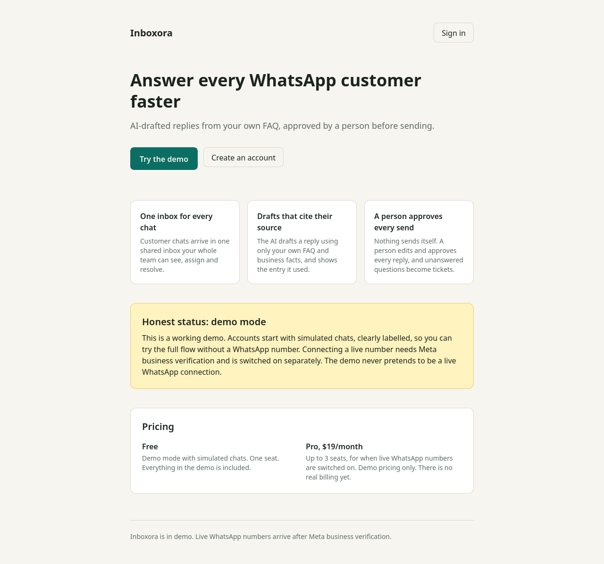
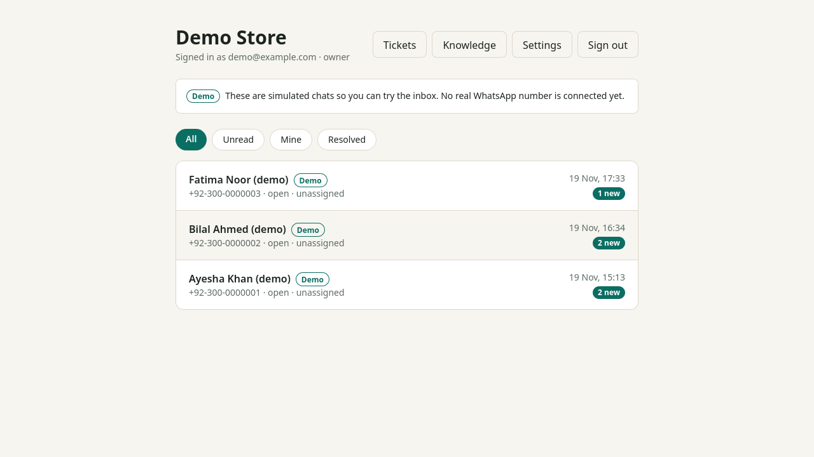
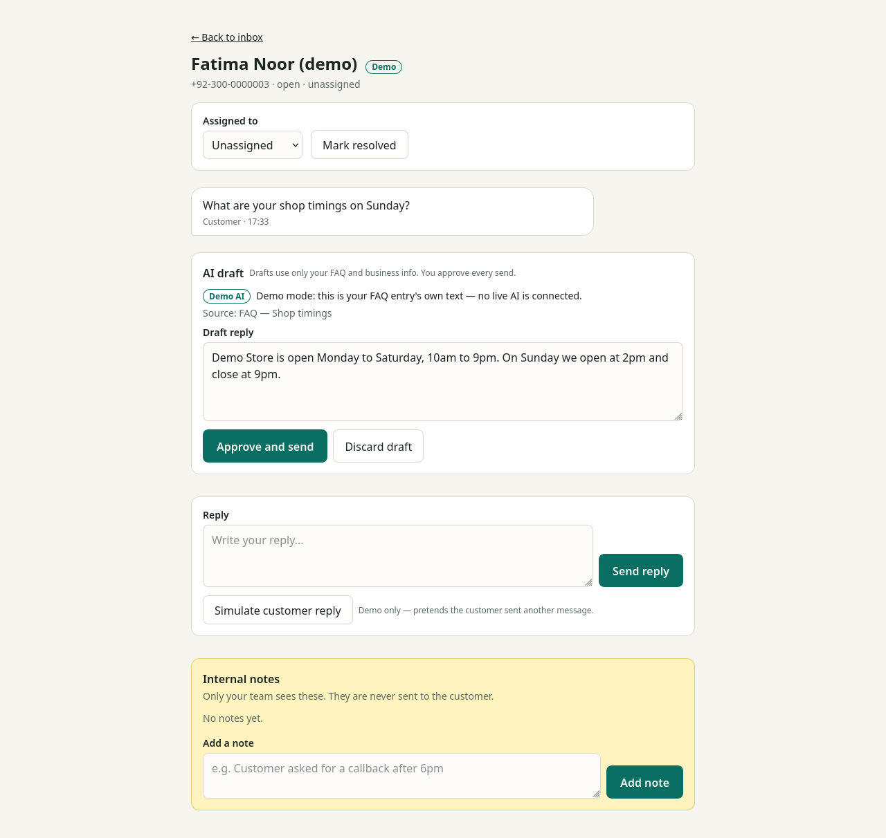

# Inboxora

One shared WhatsApp inbox for a small business. Customer chats land
in a single inbox, an AI assistant drafts replies using only the
business's own FAQ and facts (and shows the entry it used), and a
person approves every send. Anything the AI cannot answer becomes
a ticket for a human instead of a guess.

> Status: working demo. Accounts run in clearly labelled demo mode
> with simulated chats. Connecting a live WhatsApp number needs
> Meta business verification and is switched on separately — see
> [Honest limits](#honest-limits).



## Demo login

After seeding (see below), sign in with:

- Email: `demo@example.com`
- Password: `demo-password-123`

Or click **Try the demo** on the landing page.

## What works today

- Accounts and workspaces: sign up, sign in, password reset,
  invite teammates (owner + agents, 3 seats).
- Shared inbox: conversation list with All / Unread / Mine /
  Resolved filters, assign to a teammate, resolve and reopen.
- Internal notes on a conversation that customers never see.
- Business knowledge: business info form (name, hours, address,
  policies) plus FAQ entries the owner writes.
- AI reply drafts: keyword search over the FAQ and business info,
  a draft that cites its source, edit / approve-and-send / discard.
  No match means an honest "needs a human", never an invented answer.
- Tickets for chats that need a human (created automatically on
  AI no-match, or flagged manually), with open / waiting / resolved
  status.
- Demo mode: seeded simulated customers, labelled DEMO everywhere,
  plus a "simulate customer reply" button so the whole loop works
  without a WhatsApp number.
- Connect WhatsApp screen: stores Meta Cloud API credentials
  (access token encrypted at rest). Inactive — nothing sends until
  Meta business verification is done.
- `/api/health` endpoint reporting database status.
- Workspace isolation is covered by automated tests: one business
  cannot read or write another's chats, knowledge or settings.





## Local setup

Requirements: Node 24, npm.

```bash
npm install
cp .env.example .env   # fill in AUTH_SECRET at minimum
npx prisma db push     # creates the local SQLite database
npm run db:seed        # demo account + simulated chats
npm run dev            # http://localhost:3000
```

Local development uses SQLite (`DATABASE_URL="file:./dev.db"`).
The schema is kept Postgres-compatible; production uses Neon —
see [DEPLOY.md](DEPLOY.md).

Checks:

```bash
npm run lint
npm run typecheck
npm test               # unit, isolation and AI eval tests
npm run build
```

## Environment variables

Names only — real values live in `.env` locally and in Vercel in
production, never in git.

| Name | Purpose |
| --- | --- |
| `DATABASE_URL` | SQLite file locally, Neon Postgres in production |
| `AUTH_SECRET` | Signs session cookies, hashes tokens, keys token encryption |
| `APP_URL` | Public base URL used in reset/invite links |
| `SMTP_HOST`, `SMTP_PORT`, `SMTP_USER`, `SMTP_PASS`, `SMTP_FROM` | Optional email sending; without them links print to the server log |
| `LLM_PROVIDER` | `groq` (default), `mistral`, `openrouter` or `pollinations` |
| `LLM_API_KEY` | Optional free no-card key; empty means labelled demo AI mode |
| `LLM_MODEL` | Optional model override (required for OpenRouter) |

Legacy `GROQ_API_KEY` / `GROQ_MODEL` are also honoured.

## Deploy

Neon Postgres + Vercel. The full checklist — Prisma provider
switch, `db push`, seeding, env vars, build command — is in
[DEPLOY.md](DEPLOY.md).

## Honest limits

- **Demo mode first.** Live WhatsApp numbers need a Meta Business
  account, business verification (documents + website), a number
  not already on the WhatsApp app, and Meta's per-message fees.
  None of that is switched on yet; the connect screen only stores
  credentials.
- **Live AI needs a key.** Without `LLM_API_KEY`, drafts run in
  labelled demo mode and quote the FAQ entry's own text. The
  provider switch (Groq / Mistral / OpenRouter, all free no-card;
  Pollinations keyless but unreliable) is ready for deploy time.
  Live-provider failures surface as errors — the app never
  silently falls back to demo text.
- **No real billing.** Free / Pro $19 pricing in the app is demo
  pricing.
- **Text only.** No broadcasts, media messages, or payments in
  this version.
- AI search is keyword scoring over the FAQ, not embeddings.

## Tech

Next.js 16 (App Router) + TypeScript, Prisma 6, Tailwind CSS 4,
Vitest. CI runs lint, typecheck and tests on every push.
